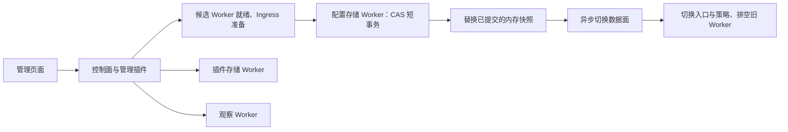

# 存储与生命周期

## 数据归属

| 数据库 | 内容 | 执行者 |
|---|---|---|
| `bungee.db` | 配置、revision、发布、恢复、监督元数据及实例菜单布局 | 配置存储 Worker |
| `plugin-state.db` | 插件状态、密钥、KV、命令日志、可靠事件、快照 | 插件存储 Worker |
| `access.db` | 请求日志、统计、插件观察数据 | 观察 Worker 处理查询及采集器提交的入口记录，请求 Worker 写入已启用的应用操作和执行尝试 |

主进程协调生命周期与消息，不执行上述数据库的查询或维护扫描。
配置快照在启动校验和成功提交后建立；普通 `getSnapshot()` 返回不可变内存投影，不执行 SQL。



提交成功、发布执行和实际服务是不同事实。切换前失败时可继续使用旧 admission；切换命令可能已发送后必须核实实际接流身份，不能假设已经回滚。停止恢复不停止已经就绪的管理插件。
完整 schema、历史关系和数据库页扫描在启动或显式 `verify()` 中运行。写事务仅校验 schema 对象指纹和当前版本关系，不扫描历史。

## 唯一插件状态接口

```ts
const record = await context.durableState.get('counter');
const [saved] = await context.durableState.transact([
  { key: 'counter', expectedVersion: record?.version ?? 0, value: 1 },
]);
const records = await context.durableState.list();
```

返回值不可修改。修改聚合对象前制作深拷贝。多条 mutation 全部提交或全部回滚；普通 CAS 不产生命令历史。
`expectedVersion: 0` 表示创建，已存在记录必须提供当前版本；删除状态可使用 `null` 值保留版本围栏。
状态与可靠事件通过同库 outbox 事务提交；可靠通道的 `publishWithState(payload, mutations)` 不接受 commandId。

有幂等要求的业务通过既有 RPC command journal 执行。`local-transaction` 纯 planner 必须声明
`atomicReadSet(execution)`，返回 `{ keys: [...] }` 或 `{ list: true }`。读集预算按本次声明读取计算；
事务提交再次校验已读版本、缺失键与完整列表，拒绝 phantom。planner 不执行外部副作用。
命令日志、业务状态和结果使用同一 SQLite 事务；外部命令继续使用已有 reconciliation 和执行者证明。

客户端的请求数量、参数字节和等待期限均有界，等待 capability 创建的调用也占用额度。
二进制参数按实际 backing buffer 计费。释放 capability 有独立的有界清理额度。
普通读取超时仅结束调用方等待，不毒化健康客户端；物理请求和业务 callback 未真正完成前仍占用额度。
RPC 使用真实业务期限；超期 callback 不能被当成已回收。连续 30 秒缺少进度时使用独立额度执行两次数据库探测，
每次最多 5 秒、间隔 1 秒。数据库故障或未完成的清理债务触发组件恢复，不能用健康 SQL 掩盖永久阻塞的 callback。
已发送写入在失联或超时时返回结果未知；幂等命令保留原 operationId，禁止换 ID 自动重执行。
释放 capability 的 ACK 不代表数据库已关闭；只有数据库关闭 ACK 才允许释放实例锁。
执行者退出证明在同一事务中将原受保护记录标记为已退出，不需要额外的记录配额；持久退出事实先于未决命令恢复。
未确认关闭时保留锁并报告资源故障，不能把发出 terminate 当成关闭证明。

## 管理能力与健康

管理身份由选中的 `ManagementProvider` 插件实现。核心按声明发现 provider，先启动其本地 control 依赖，再启动数据面。
用户名、密码、会话、登录限流和身份恢复都属于插件；核心不按内置账户插件名分支。
已安装的 provider 不可用时拒绝管理访问。没有强制认证且未选择 provider 时采用匿名管理；强制认证 guard 与 provider 激活由配置 Worker 原子持久化。在线停用、替换或导入不能解除；主动解除使用停机本地 TTY 的 `release-auth`。启动时已不存在的 provider 按下述插件目录整理规则清除选择。
无关 control 或观察 adapter 初始化失败仅影响依赖该能力的消费者。

`/health` 提供 `live`、`management`、`data`、`degraded`；没有已确认的服务 Worker 时 `data=false`。
`/health/management` 和 `/health/data` 分别检查对应就绪状态。恢复停止或发布降级不会被报告为数据面正常。

用户认证插件通过既有 durableState／CAS 保存 schema 3 记录，拆分用户、本地凭据、外部身份绑定、登录连接、安全设置和初始化／恢复锚点，不新增插件状态表或迁移。会话、限流和短期认证流程使用固定容量记录。改密、禁用和绑定变化推进对应用户 generation；全局撤销及离线 `reset` 推进 sessionEpoch；`reset-password` 只推进目标用户 generation，保留其他用户会话。两个重置动作均推进 failureEpoch，使旧限流状态失效。连接代际使配置变更前的相关会话和在途流程失效。clock 以 CAS 保存已观察时间，防止回拨或重启复活过期凭据。普通认证不会记录完整账户命令历史；完整记录约束见[用户认证插件](../../plugins/user-auth/README.md#会话与持久化)。

user-auth 的状态查询只取得 `get/list`，空命名空间返回未初始化，不启动 control 或写库。插件启动时通过 CAS 为真正的空命名空间建立最小 `uninitialized` 元数据；首个用户、本地凭据、ready 状态与稳定恢复锚点在插件库同一事务提交。在线启用随后提交配置库的强制认证与 provider 选择，跨库不提供共同事务；配置提交失败时保留已创建账号，后续转为已有账号验证。ready 状态下用户缺失或记录损坏明确拒绝，不自动重开初始化。

历史 schema 3 待初始化记录中的 `setup.code` 由插件统一读取投影，并在插件启动或离线维护时以 CAS 清理；只读查询不清理记录。不新增核心迁移，不改变 ready 用户格式与 ID。非当前 schema 记录明确拒绝，不转换；user-auth 不读取、导入、迁移或清理旧账号、Cookie 或 `local-accounts` 命名空间。

离线 `add-user` 可在空命名空间建立首个 ready 用户；`reset-password` 按用户名修改凭据，保留 ID、绑定和 disabled 状态。`reset` 依稳定恢复锚点保留原 ID，允许重建该账号缺失或损坏的身份和本地凭据，不根据用户名猜测锚点，不自动修复任意损坏状态。它撤销全部会话和在途流程，保留其他用户、外部绑定及登录配置。宿主只负责动作分发、命名空间、TTY、实例锁及关闭 ACK；不先启动插件或读取初始化状态，也不为账号动作修改 provider 选择或强制认证。

正常启动和离线恢复打开配置库时，配置 Worker 按已验证的插件目录移除不存在插件的激活、各作用域绑定及对应的上游托管标记，保留路由、服务、上游目标和已安装插件配置。所选管理 provider 已不存在时，同时清除其强制认证选择，恢复匿名管理，用户可重新初始化认证。清理通过新 revision 和原子事务完成，不改写历史快照，不触碰插件业务状态或执行账号迁移；重复打开不再产生 revision。未提供目录的检查工具不执行清理，尚未完成的发布或恢复不会被覆盖。插件业务格式迁移由插件负责，核心不按具体插件名转换数据。

## 数据库基线与升级

三库以版本 1 定义初始化，升级通过追加连续迁移执行。

| 数据库 | 初始基线 | 后续第一版 | 定义与注册入口 |
| --- | --- | --- | --- |
| `bungee.db` | 1 / `current_storage_baseline` | 2 | [配置 schema](../../packages/core/src/config-storage/schema.ts)、[迁移计划](../../packages/core/src/config-storage/migrations/plan.ts) |
| `access.db` | 001 / `current_access_baseline` | 002 | [日志 schema](../../packages/core/src/migrations/schema.ts)、[迁移注册](../../packages/core/src/migrations/index.ts) |
| `plugin-state.db` | `PRAGMA user_version=1` | 2 | [插件状态 schema](../../packages/core/src/plugin-state/schema.ts) |

日志库迁移 006 添加访问、应用操作和执行尝试的关联字段。HTTP 访问与关联执行组成一条查询链，WS 按已识别的客户端业务请求查询。旧连接和内部执行记录仍可按原记录 ID 查询，默认列表和统计排除这些记录。迁移保留既有行的身份和结果字段，新增字段对既有行为空。

配置库迁移 9 添加请求日志默认激活的结算记录。安装目录包含 `request-logs` 时，存储通过配置提交事务写入一次默认激活。发布或恢复持有配置时延后，恢复后的发布队列会重新检查。显式保存的激活列表具有优先权。

配置库迁移 4（`management_protection`）添加强制认证 guard，记录 required、selected provider 与 generation；它不进入普通配置导入导出。插件状态库继续使用现有表，插件业务记录格式独立于数据库迁移编号。

配置库迁移 5（`service_references`）将 Route 的单一 Service 关联转换为独立关系行，并移除 `routes.service_id` 列。关系表区分 Route 和 Service 所有者，目标使用稳定 Service ID；引用具有独立 ID、position、weight、priority 和 disabled 状态。Route 和 Service 均可同时拥有 endpoints 与服务引用，两类目标共用所属对象当前层的 position 分组；关系读取、配置校验与运行时编译均保留完整的混合目标集合。

配置库迁移 8（`publication_targets_and_cancellation`）增加待领取和被取代状态、唯一发布归属、取消与切换准备围栏，以及按 operation、slot、attempt 绑定的不可变候选退出证明；启动账本记录尝试预占、绑定进程身份与原始 guard 的 fork 前意图及退出／清理事实。迁移不翻译未完成的发布，不使用当前 catalog 猜测旧 owner 身份；须先按升级前置条件安全完成原有操作。

配置库迁移 10（`worker_launch_capacity`）添加只追加的容量回收事实，通过 Worker 实例身份关联不可变启动意图。迁移不补写历史事实。Master 在首次确认原始生命周期锁已释放后写入；该记录只用于创建容量，不能替代发布、退休或资源清理证明。仅支持迁移 9 的可执行程序不会打开已迁移到 10 的数据库。

已有库首次由配置 Worker 打开时自动升级，包括 Docker 和 CLI 升级后的首次启动。转换改变配置内容时，在结构迁移的同一事务内通过既有 CAS 提交机制创建新 revision 与匹配的 operation/request identity；旧 revision、hash 和 serving snapshot 保持不可变。新库及内容未改变的库不产生转换 revision，重复打开不再次产生 revision。启动审计校验历史快照的原始规范化字节、hash 和 revision 关系；历史格式只能审计，不能作为当前运行配置加载。

常规升级遇到未完成的发布、未释放的 retirement 或当前 revision 未成功的 recovery 时，保留原运行记录并要求先完成该操作。配置库迁移 11 为已确认停止的 Docker 实例提供离线接管。它在同一事务内校验数据库、迁移并写入新的运行边界。历史发布及退出记录可按原身份查询，退出或清理未确认的状态仍保留。新实例仅使用当前边界的进程记录，并用当前插件目录应用最新已保存配置。离线流程见 [Docker Compose 部署](../guides/deployment.md#docker-compose)。

配置库迁移 12 允许在线保存事务为已经就绪的进程绑定一次发布尝试。启动意图在 fork 前写入。保存事务核对同一进程的身份和原始生命周期锁，再绑定发布尝试。进程身份与锁记录始终不可修改。

`configuration_state.schema_version=4` 是内部状态记录格式，不是数据库迁移编号。配置 revision、监督 epoch 和插件记录版本分别标识不同对象。

新实例初始化配置库及同目录的插件状态库，日志库随正常启动创建。启动只接受受支持的迁移前缀及结构，不会自动重置不匹配的数据库。初始化不创建核心账户；身份仍归选中的管理插件。

升级约束：

1. 冻结已交付的基线和迁移；为发生变化的库追加连续版本。
2. `up(db)` 仅执行同库 SQL，不自行提交、访问外部服务或触发业务命令。
3. DDL、数据变更与迁移记录在同一事务提交；失败全部回滚。
4. 新库执行基线和增量步骤，已有库只执行未应用步骤。未知未来版本、缺失记录或结构指纹不符拒绝启动，不能将“列已存在”当作升级成功。
5. 结构变更需要覆盖数据保留、回滚和重开验证。交付前备份完整实例状态。

迁移在各库的执行 Worker 内完成；普通内存配置读取不参与迁移或维护扫描。

## 配置记录、导入和恢复

实例菜单布局使用独立记录和菜单 revision，通过同一存储 Worker 的 CAS 短事务更新。
菜单保存不改变代理配置 revision，不创建发布操作或更替数据面 Worker。
布局随实例数据库备份保存，不进入代理配置导入和导出。图标只保存集合与名称标识；
离线图标数据属于发布资源，不写入数据库。

配置库保存当前规范化的 settings、services、routes、upstreams、service references、插件 binding 和 activation，以及 revision、操作、发布、恢复和监督元数据。插件业务状态不能写进配置聚合；会话触碰也不能产生成套配置历史。

在线配置先编译校验，等待候选 Worker 实际就绪及 Ingress 准备完成，再用 `expected_revision` 在短事务中比较并提交。该事务同时记录候选发布归属、接流证据及退役清单。CAS 成功才替换已保存的内存投影并允许切流。旧发布、恢复或排空占用发布能力时，在线保存需要等待发布队列可用。配置冲突需重新读取后编辑。数据库 revision 与正在接流的 revision 分开查询。

正在执行的发布由独立的持久归属及冻结快照标识，不随最新配置变化。后台空闲时领取最新目标；尚未领取的中间目标可被取代。已经启动的候选只能在流量切换准备前取消，并在确认退出与必要资源清理后记录被取代、释放归属。进入准备阶段后，切换和恢复沿原目标身份继续。未知退出、清理或释放结果不能通过提交新配置抹除。

领取在同一配置事务内核对最新 revision、校验当前聚合 hash、写入不可变快照并取得发布归属。领取前的完整最新目标由当前配置投影保存；领取后的目标由冻结快照保存。未领取即被取代的历史目标仅保留 revision 和操作审计摘要，不提供完整配置历史重放。

在线准备期间，候选 Worker 可读取其已激活插件的命名空间并查询声明的 bootstrap RPC。存储写入、观察写入和请求能力按实际 admission 授权。候选清理释放该尝试拥有的资源。保存记录和快照提供持久化证据，Ingress 签名状态提供接流证据。

启动器必须先提交启动意图，再创建进程。没有意图的预占只能通过原子围栏确认为未启动，并禁止随后注册该尝试。物理退出与资源清理分别取证：前者核对原始 guard 或精确进程身份，后者核对 worker 签名的关闭清理结果。初始化取消及插件收尾要求见[插件 SDK 参考](../reference/plugin-api.md#插件实例)。

全局占用库存包含历史发布和不绑定发布的启动进程；曾经 admitted、描述文件缺失或未出现在未接纳查询中，都不等于已释放。运行时按新鲜可信的 admission 精确核对合法成员，先处理既有债务，再决定是否允许创建进程。恢复屏障跨 revision 生效，手动恢复也不能绕过其他 `stopped` 且安全结果未知的恢复；排除当前恢复时仍须检查其余记录。

导出封装的 `content_hash` 校验规范化聚合内容；`source_revision` 只表示来源。导入先核对源封装 hash，再按当前 catalog 编译依赖闭包，预览与提交使用一致的整理规则。导入不替换插件业务状态、密钥或观察日志，也不直接替换运行中的数据库文件。字段与错误语义见[配置参考](../reference/configuration.md)。

发布操作绑定 revision、内容 hash、catalog、attempt 和运行身份。恢复依据持久操作状态及实际进程证据推进；不能凭超时猜测提交失败，也不能为未知业务命令换 ID 重执行。恢复进入 stopped 保留已就绪管理能力，安全重试仍走协调入口。

配置库使用 DELETE journal、FULL synchronous；插件状态库使用 WAL、FULL synchronous。两者启用外键和 5000 ms busy timeout。观察库 journal 由[日志库打开契约](../../packages/core/src/access-database.ts)选择并校验，不能在运行中由另一个连接强行切换。

JS 构建须包含配置、插件状态和观察 Worker 入口；独立二进制嵌入相同入口。关闭 ACK 是释放实例锁的前提。

身份和业务状态恢复调用[离线插件恢复](../guides/offline-recovery.md)能力。物理备份要求整个实例停止，并保留 data、logs、秘密存储密钥及 SQLite 侧文件；配置导出不能替代完整备份。
